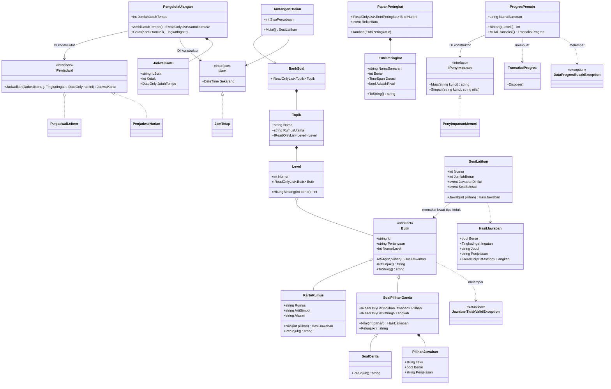

# Mathflash: Aplikasi Flashcard Pengulangan Berjarak untuk Penguasaan Rumus Matematika SMP Kelas 8

**Nomor Kelompok:** kel02

Mathflash adalah aplikasi pembelajaran desktop Windows luring untuk membantu siswa SMP kelas 8 menghafal dan memahami penerapan rumus matematika. Aplikasi ini memadukan metode flashcard pengulangan berjarak (*spaced repetition*) ala Anki dengan papan peringkat tantangan harian lokal, serta menyediakan umpan balik edukatif ringkas setiap kali jawaban keliru. Pendekatan ini dirancang untuk mengatasi kesulitan mengingat rumus, kejenuhan membaca penjelasan panjang, dan rasa cemas saat membuat kesalahan, sekaligus menjaga motivasi belajar mandiri melalui unsur kompetitif.

## Tautan

- Repositori proyek: https://github.com/ishamhaa/Proyek-Akhir-PBO_Kelompok02
- Paket rilis (GitHub Releases, zip yang dapat langsung dijalankan): https://github.com/ishamhaa/proyek-akhir-pbo_kelompok02/releases/tag/v0.1.0-kerangka (pos M1: masih berisi kerangka)

## Kelompok

| Nama | NRP | Akun GitHub |
|---|---|---|
| Isham Hawali Arijuddin | 5025251079 | ishamhaa |
| Rizqi Ardiansyah Putra Pratama | 5025251211 | Ciko1140 |
| Wistara Banyu Kayana | 5025251098 | wistarabanyukayana |

## Ide dan pembeda

- Ide dalam satu kalimat: Mathflash adalah aplikasi desktop Windows luring yang memadukan flashcard pengulangan berjarak (*spaced repetition*) ala Anki, umpan balik edukatif ringkas saat jawaban keliru, dan papan peringkat tantangan harian lokal agar siswa SMP kelas 8 dapat langsung memasang dan memakainya untuk menghafal serta memahami penerapan rumus matematika.
- Apa yang membuatnya berbeda dari aplikasi serupa lain:
  - **Langsung pasang dan pakai (*plug-and-play*):** Dirancang agar siswa dan guru cukup memasang atau mengekstrak aplikasi lalu langsung memakainya secara luring tanpa akun, internet, atau konfigurasi dek manual seperti pada aplikasi flashcard umum.
  - **Fokus hafalan sekaligus pemahaman penerapan rumus:** Ditujukan khusus untuk rumus matematika SMP kelas 8 beserta penerapannya, bukan sekadar kuis pilihan ganda biasa atau hafalan pasif.
  - **Umpan balik edukatif ringkas saat keliru:** Memberi penjelasan singkat ketika jawaban salah untuk menghindari kejenuhan membaca materi panjang sekaligus mengurangi rasa cemas saat berbuat salah.
  - **Papan peringkat tantangan harian lokal:** Menghadirkan unsur kompetitif lokal tanpa server untuk menjaga motivasi belajar mandiri siswa.

## Untuk guru

- Mata pelajaran dan jenjang: Matematika, SMP/MTs kelas 8 (Fase D, Kurikulum Merdeka).
- Tujuan belajar:
  1. Siswa dapat menuliskan rumus yang dipelajari dan menjelaskan arti setiap simbolnya (mis. pada c² = a² + b², c adalah sisi miring).
  2. Siswa dapat memilih dan memakai rumus yang tepat untuk menyelesaikan soal hitungan dan soal cerita sederhana.
  3. Siswa dapat menunjukkan letak kesalahan pada jawaban yang keliru (mis. menjumlahkan sisi sebelum dikuadratkan) dan memperbaikinya.
- Cakupan materi (dan sumber rujukannya): rumus pada materi Matematika kelas 8, yaitu Bilangan Berpangkat, Teorema Pythagoras, Persamaan Garis Lurus, dan Statistika. Tiap topik memiliki 3 level: (1) kartu rumus, (2) soal hitungan, (3) soal cerita, dengan total minimal 30 butir. Rujukan: *Buku Guru Matematika untuk SMP/MTs Kelas VIII* (Kurikulum Merdeka, Kemendikbudristek), https://repositori.kemendikdasmen.go.id/35886/1/Matematika-BG-KLS-VIII-Baru.pdf. Setiap butir dicek silang oleh anggota lain, dan divalidasi guru matematika bila bersedia.
- Cara menjalankan dan memakai:
  1. Unduh berkas zip dari tautan **Paket rilis** di atas, lalu ekstrak ke satu folder.
  2. Jalankan `Aplikasi.exe` (Windows 10/11, tidak perlu memasang .NET atau Visual Studio).
  3. (Alur yang direncanakan; paket pos M1 masih berupa kerangka.) Di Beranda, pilih topik, lalu mulai dari Level 1 (kartu rumus). Tekan "Balik kartu", lalu pilih Lupa, Ragu, atau Ingat.
  4. Lanjutkan ke Level 2 dan 3 (soal). Bila jawaban keliru, aplikasi menampilkan penjelasan singkat dan langkah yang benar.
  5. Tombol "Ulang sekarang" di Beranda memunculkan kartu yang waktunya diulang. "Tantangan harian" berisi 10 soal acak dengan papan peringkat di komputer ini.
  6. Progres tersimpan otomatis di `%AppData%\Mathflash\progres.json`. Tidak ada akun, internet, atau data pribadi.

## Rancangan

Jelaskan singkat arsitektur aplikasi dan pola desain yang dipakai (mis. Strategy untuk penilaian). Tempel diagram kelas (Mermaid)
yang cocok dengan kode.

Rancangan awal (pos M1, akan disesuaikan dengan kode):

- Proyek **Logika** memuat seluruh aturan: isi pelajaran (`BankSoal` → `Topik` → `Level` → `Butir`), penilaian jawaban, penjadwalan ulang kartu, tantangan harian, papan peringkat, dan progres. Logika tidak merujuk Windows Forms. Waktu dan penyimpanan masuk lewat interface `IJam` dan `IPenyimpanan`.
- Proyek **Aplikasi** berisi satu `FormUtama` yang menukar satu UserControl per layar (Beranda, Kartu, Soal, Hasil, Peringkat), plus `JamSistem` dan `PenyimpananBerkas` (JSON di `%AppData%\Mathflash`).
- Pola desain: **Strategy** untuk penjadwalan ulang (`IPenjadwal` dengan `PenjadwalLeitner` dan `PenjadwalHarian`), **Observer** lewat event (`SesiLatihan.JawabanDinilai`, `SesiLatihan.SesiSelesai`, `PapanPeringkat.RekorBaru`) yang dilanggan form.



## Cara menjalankan (untuk pengembang)

```bash
dotnet run --project src/Aplikasi     # menjalankan aplikasi
```

## Membuat paket rilis

```bash
dotnet publish src/Aplikasi -c Release -r win-x64 --self-contained true -o terbit
```

Kompres folder `terbit` menjadi zip, lalu unggah ke GitHub Releases di repo ini (tab Releases > Draft a new release).
Salin tautannya ke bagian **Tautan** di atas. Uji paket itu di komputer lain sebelum pos berikutnya.

## Status persyaratan

Isi dengan `selesai`, `sebagian`, atau `belum`.

| ID | Persyaratan | Status | Catatan |
|---|---|---|---|
| P1-P7 | Produk (ide, pedagogi, dapat dijalankan, progres, etika, uji coba, panduan) | sebagian | Ide, proposal, dan mockup selesai; kerangka berjalan; isi dan uji coba belum |
| K1-K5 | Enkapsulasi, komposisi/pewarisan, polimorfisme, abstract/interface/DI, exception/life cycle | sebagian | Rancangan kelas ada di bagian Rancangan; `Butir` (abstract) dan `Level` sudah dibuat, sisanya pos M2 |
| K6 | Event | belum | Direncanakan: `JawabanDinilai`, `SesiSelesai`, `RekorBaru` |
| K7 | Logika murni | sebagian | Kerangka sudah memisahkan Logika dan Aplikasi; dijaga di setiap PR |

## Yang belum selesai

- Kelas inti Logika (K1-K4) dan satu alur belajar dari awal sampai akhir (target pos M2, 29 November 2026).
- Isi lengkap minimal 30 butir, exception, event, dan uji coba pada minimal 3 pengguna (target pos M3, 6 Desember 2026).
- Validasi isi: cek silang ke Buku Guru oleh anggota lain, dan oleh guru matematika bila bersedia.
