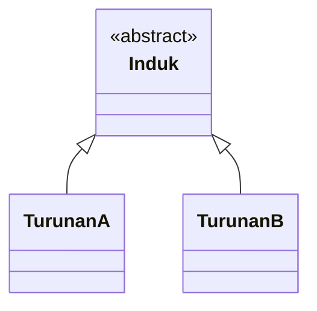

# Mathflash: Aplikasi Flashcard Pengulangan Berjarak untuk Penguasaan Rumus Matematika SMP Kelas 8

**Nomor Kelompok:** kel02

Mathflash adalah aplikasi pembelajaran desktop Windows luring untuk membantu siswa SMP kelas 8 menghafal dan memahami penerapan rumus matematika. Aplikasi ini memadukan metode flashcard pengulangan berjarak (*spaced repetition*) ala Anki dengan papan peringkat tantangan harian lokal, serta menyediakan umpan balik edukatif ringkas setiap kali jawaban keliru. Pendekatan ini dirancang untuk mengatasi kesulitan mengingat rumus, kejenuhan membaca penjelasan panjang, dan rasa cemas saat membuat kesalahan, sekaligus menjaga motivasi belajar mandiri melalui unsur kompetitif.

> Baca `SOAL.md` dulu. Proposal dan Laporan Akhir dikumpulkan di Classroom (bukan di repo). Ganti semua `TULIS_DI_SINI` di berkas ini dan berkas catatan lain. Berkas yang masih memuat
> `TULIS_DI_SINI` dianggap belum diisi.

## Tautan

- Repositori proyek: https://github.com/ishamhaa/Proyek-Akhir-PBO_Kelompok02
- Paket rilis (GitHub Releases, zip yang dapat langsung dijalankan): TULIS_DI_SINI

## Kelompok

| Nama | NRP | Akun GitHub |
|---|---|---|
| Isham Hawali Arijuddin | 5025251079 | ishamhaa |
| Rizqi Ardiansyah Putra Pratama | 5025251211 | Ciko1140 |
| Wistara Banyu Kayana | 5025251098 | wistarabanyukayana |

## Ide dan pembeda

- Ide dalam satu kalimat: Mathflash adalah aplikasi desktop Windows luring yang memadukan flashcard pengulangan berjarak (*spaced repetition*) ala Anki, umpan balik edukatif ringkas saat jawaban keliru, dan papan peringkat tantangan harian lokal agar siswa SMP kelas 8 dapat langsung memasang dan memakainya untuk menghafal serta memahami penerapan rumus matematika.
- Apa yang membuatnya berbeda dari aplikasi serupa lain:
  - **Langsung pasang dan pakai (*plug-and-play*):** Dirancang agar siswa dan guru cukup memasang atau mengekstrak aplikasi lalu langsung memakainya secara luring tanpa akun, internet, atau konfigurasi dek manual seperti pada aplikasi flashcard umum.
  - **Fokus hafalan sekaligus pemahaman penerapan rumus:** Ditujukan khusus untuk rumus matematika SMP kelas 8 beserta penerapannya, bukan sekadar kuis pilihan ganda biasa atau hafalan pasif.
  - **Umpan balik edukatif ringkas saat keliru:** Memberi penjelasan singkat ketika jawaban salah untuk menghindari kejenuhan membaca materi panjang sekaligus mengurangi rasa cemas saat berbuat salah.
  - **Papan peringkat tantangan harian lokal:** Menghadirkan unsur kompetitif lokal tanpa server untuk menjaga motivasi belajar mandiri siswa.

## Untuk guru

- Mata pelajaran dan jenjang: TULIS_DI_SINI
- Tujuan belajar: TULIS_DI_SINI
- Cakupan materi (dan sumber rujukannya): TULIS_DI_SINI
- Cara menjalankan dan memakai: TULIS_DI_SINI

## Rancangan

Jelaskan singkat arsitektur aplikasi dan pola desain yang dipakai (mis. Strategy untuk penilaian). Tempel diagram kelas (Mermaid)
yang cocok dengan kode.



TULIS_DI_SINI

## Cara menjalankan (untuk pengembang)

```bash
dotnet run --project src/Aplikasi     # menjalankan aplikasi
```

## Membuat paket rilis

```bash
dotnet publish src/Aplikasi -c Release -r win-x64 --self-contained true -o terbit
```

Kompres folder `terbit` menjadi zip, lalu unggah ke GitHub Releases di repo ini (tab Releases > Draft a new release).
Salin tautannya ke bagian **Tautan** di atas. Uji paket itu di komputer lain sebelum pos berikutnya.

## Status persyaratan

Isi dengan `selesai`, `sebagian`, atau `belum`.

| ID | Persyaratan | Status | Catatan |
|---|---|---|---|
| P1-P7 | Produk (ide, pedagogi, dapat dijalankan, progres, etika, uji coba, panduan) | TULIS_DI_SINI | |
| K1-K5 | Enkapsulasi, komposisi/pewarisan, polimorfisme, abstract/interface/DI, exception/life cycle | TULIS_DI_SINI | |
| K6 | Event | TULIS_DI_SINI | |
| K7 | Logika murni | TULIS_DI_SINI | |

## Yang belum selesai

TULIS_DI_SINI (tulis "tidak ada" bila semuanya selesai)
