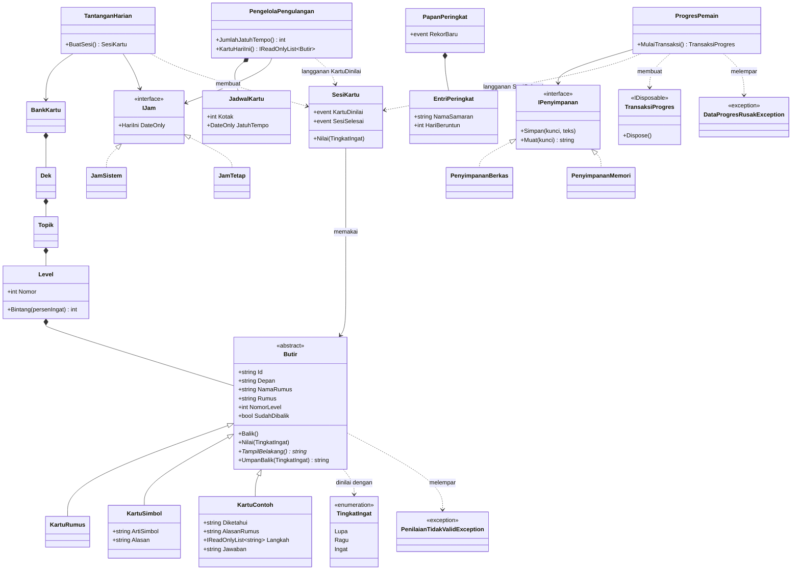

# Mathflash: Aplikasi Flashcard Pengulangan Berjarak untuk Penguasaan Rumus Matematika Kelas 5 SD dan Kelas 9 SMP

**Nomor Kelompok:** kel02

Mathflash adalah aplikasi pembelajaran desktop Windows luring untuk membantu siswa kelas 5 SD dan kelas 9 SMP menghafal dan memahami penerapan rumus matematika. Aplikasi ini memadukan metode flashcard pengulangan berjarak (*spaced repetition*) ala Anki dengan papan peringkat tantangan harian lokal, serta menyediakan umpan balik ringkas setiap kali siswa menilai ingatannya. Pendekatan ini dirancang untuk mengatasi kesulitan mengingat rumus, kejenuhan membaca penjelasan panjang, dan rasa cemas saat membuat kesalahan, sekaligus menjaga motivasi belajar mandiri melalui unsur kompetitif.

## Tautan

- Repositori proyek: https://github.com/ishamhaa/Proyek-Akhir-PBO_Kelompok02
- Paket rilis (GitHub Releases, zip yang dapat langsung dijalankan): https://github.com/ishamhaa/proyek-akhir-pbo_kelompok02/releases/tag/v0.1.0-kerangka (pos M1: masih berisi kerangka)

## Kelompok

| Nama | NRP | Akun GitHub |
|---|---|---|
| Isham Hawali Arijuddin | 5025251079 | ishamhaa |
| Rizqi Ardiansyah Putra Pratama | 5025251211 | Ciko1140 |
| Wistara Banyu Kayana | 5025251098 | wistarabanyukayana |

## Ide dan pembeda

- Ide dalam satu kalimat: Mathflash adalah aplikasi desktop Windows luring yang memadukan flashcard pengulangan berjarak (*spaced repetition*) ala Anki, umpan balik ringkas setelah siswa menilai ingatannya, dan papan peringkat tantangan harian lokal agar siswa kelas 5 SD dan kelas 9 SMP dapat langsung memasang dan memakainya untuk menghafal serta memahami penerapan rumus matematika.
- Apa yang membuatnya berbeda dari aplikasi serupa lain:
  - **Langsung pasang dan pakai (*plug-and-play*):** Dirancang agar siswa dan guru cukup memasang atau mengekstrak aplikasi lalu langsung memakainya secara luring tanpa akun, internet, atau konfigurasi dek manual seperti pada aplikasi flashcard umum.
  - **Fokus hafalan sekaligus pemahaman penerapan rumus:** Ditujukan khusus untuk semua rumus wajib matematika kelas 5 dan kelas 9 beserta penerapannya, bukan sekadar kuis pilihan ganda biasa atau hafalan pasif.
  - **Umpan balik ringkas tanpa nilai salah:** Siswa menilai ingatannya sendiri (Lupa, Ragu, Ingat), lalu mendapat penjelasan singkat, sehingga tidak jenuh membaca materi panjang dan tidak cemas saat lupa.
  - **Papan peringkat tantangan harian lokal:** Menghadirkan unsur kompetitif lokal tanpa server untuk menjaga motivasi belajar mandiri siswa.

## Untuk guru

- Mata pelajaran dan jenjang: Matematika, SD/MI kelas 5 (Fase C) dan SMP/MTs kelas 9 (Fase D), Kurikulum Merdeka.
- Tujuan belajar:
  1. Siswa dapat menuliskan rumus yang dipelajari dan menjelaskan arti setiap simbolnya (mis. pada V = π × r² × t, r adalah jari-jari alas tabung).
  2. Siswa dapat memilih dan memakai rumus yang tepat untuk menyelesaikan soal hitungan dan soal cerita sederhana.
  3. Siswa dapat menjelaskan alasan memilih rumus dan mengenali kesalahan dalam pengerjaannya dengan mencocokkan langkah di sisi belakang kartu.
- Cakupan materi (dan sumber rujukannya): semua rumus wajib kelas 5 (luas bangun datar, keliling lingkaran dan volume, sudut bangun datar, rata-rata dan kepadatan) dan kelas 9 (lingkaran, bangun ruang sisi datar dan sisi lengkung, transformasi geometri, peluang). Tiap topik memiliki 3 level kartu: (1) Kenali Rumus, (2) Arti dan Alasan, (3) Contoh Pakai (hitungan singkat atau soal cerita); 57 kartu inti lalu 90 kartu tambahan. Rujukan: buku teks utama Kurikulum Merdeka (Pusat Perbukuan) di [SIBI Kemendikdasmen](https://buku.kemendikdasmen.go.id/katalog/buku-kurikulum-merdeka): *Belajar Bersama Temanmu Matematika untuk Sekolah Dasar Kelas V* Volume 1 (ISBN 978-602-244-812-9) dan Volume 2 (ISBN 978-602-244-813-6), serta [*Matematika untuk SMP/MTs Kelas IX*](https://buku.kemendikdasmen.go.id/katalog/matematika-untuk-smpmts-kelas-ix) Bab II-IV (ISBN 978-602-427-918-9). Setiap kartu dicek silang oleh anggota lain, dan divalidasi guru matematika bila bersedia.
- Cara menjalankan dan memakai:
  1. Unduh berkas zip dari tautan **Paket rilis** di atas, lalu ekstrak ke satu folder.
  2. Jalankan `Aplikasi.exe` (Windows 10/11, tidak perlu memasang .NET atau Visual Studio).
  3. (Alur yang direncanakan; paket pos M1 masih berupa kerangka.) Di Beranda, pilih tab Kelas 5 atau Kelas 9 dan satu topik, lalu mulai dari Level 1. Tekan "Balik kartu", lalu pilih Lupa, Ragu, atau Ingat.
  4. Lanjutkan ke Level 2 dan 3. Sisi belakang kartu Level 3 memuat yang diketahui, alasan memilih rumus, langkah, dan jawabannya.
  5. Tombol "Ulang sekarang" di Beranda memunculkan kartu yang waktunya diulang. "Tantangan harian" berisi 10 kartu acak dengan papan peringkat hari beruntun di komputer ini.
  6. Progres tersimpan otomatis di `%AppData%\Mathflash\progres.json`. Tidak ada akun, internet, atau data pribadi.

## Rancangan

Jelaskan singkat arsitektur aplikasi dan pola desain yang dipakai (mis. Strategy untuk penilaian). Tempel diagram kelas (Mermaid)
yang cocok dengan kode.

Rancangan awal (pos M1, akan disesuaikan dengan kode):

- Proyek **Logika** memuat seluruh aturan: isi pelajaran (`BankKartu` → `Dek` → `Topik` → `Level` → `Butir`), penilaian ingatan, penjadwalan ulang kartu, tantangan harian, papan peringkat, dan progres. Logika tidak merujuk Windows Forms. Waktu dan penyimpanan masuk lewat interface `IJam` dan `IPenyimpanan`.
- Proyek **Aplikasi** berisi satu `FormUtama` yang menukar satu UserControl per layar (Beranda, Level, Kartu, Hasil, Peringkat, Cara Pakai), plus `JamSistem` dan `PenyimpananBerkas` (JSON di `%AppData%\Mathflash`).
- Pola desain: **polimorfisme** lewat `Butir.TampilBelakang()` dan `UmpanBalik()` pada tiga jenis kartu (`KartuRumus`, `KartuSimbol`, `KartuContoh`), **Observer** lewat event (`SesiKartu.KartuDinilai`, `SesiKartu.SesiSelesai`, `PapanPeringkat.RekorBaru`) yang dilanggan `PengelolaPengulangan`, `ProgresPemain`, dan form.



## Cara menjalankan (untuk pengembang)

```bash
dotnet run --project src/Aplikasi     # menjalankan aplikasi
```

## Membuat paket rilis

```bash
dotnet publish src/Aplikasi -c Release -r win-x64 --self-contained true -o terbit
```

Kompres folder `terbit` menjadi zip, lalu unggah ke GitHub Releases di repo ini (tab Releases > Draft a new release).
Salin tautannya ke bagian **Tautan** di atas. Uji paket itu di komputer lain sebelum pos berikutnya.

## Status persyaratan

Isi dengan `selesai`, `sebagian`, atau `belum`.

| ID | Persyaratan | Status | Catatan |
|---|---|---|---|
| P1-P7 | Produk (ide, pedagogi, dapat dijalankan, progres, etika, uji coba, panduan) | sebagian | Ide, proposal, dan mockup selesai; kerangka berjalan; isi dan uji coba belum |
| K1-K5 | Enkapsulasi, komposisi/pewarisan, polimorfisme, abstract/interface/DI, exception/life cycle | sebagian | Rancangan kelas ada di bagian Rancangan; `Butir` (abstract) dan `Level` sudah dibuat, sisanya pos M2 |
| K6 | Event | belum | Direncanakan: `KartuDinilai`, `SesiSelesai`, `RekorBaru` |
| K7 | Logika murni | sebagian | Kerangka sudah memisahkan Logika dan Aplikasi; dijaga di setiap PR |

## Yang belum selesai

- Persetujuan dosen atas perubahan rancangan 24 November 2026 (sasaran kelas 5 dan kelas 9, hanya kartu tanpa soal pilihan ganda), sebelum pos M2.
- Kelas inti Logika (K1-K4) dan satu alur belajar dari awal sampai akhir (target pos M2, 29 November 2026).
- Isi 57 kartu inti (90 kartu tambahan menyusul sebelum batas akhir), exception, event, dan uji coba pada minimal 3 pengguna (target pos M3, 6 Desember 2026).
- Validasi isi: cek silang ke buku teks Kelas V dan Kelas IX oleh anggota lain, dan oleh guru matematika bila bersedia.
